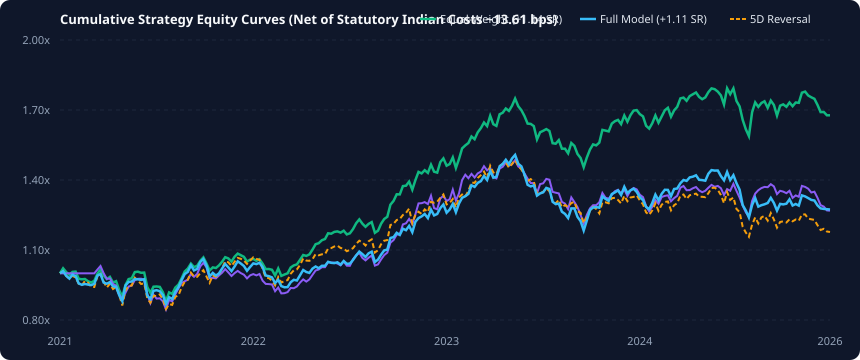

# SignalForge: Quantitative Feature Engineering & Portfolio Benchmark Pipeline

[](https://github.com/your-username/signalforge/actions)
[](tests/)
[](pyproject.toml)
[](LICENSE)

SignalForge is an empirical quantitative research framework designed for cash equity markets (tested on National Stock Exchange of India large caps). It provides automated scale-free feature engineering, multi-stage IC feature selection, nested walk-forward cross-validation with trading-day embargo purging, matrix panel backtesting with portfolio weight drift, and rigorous statistical hypothesis tests.

---

## 📈 Cumulative Strategy Equity Curves



---

## 🧠 Executive Summary: What I Found and Why

This project began with a goal common among quant researchers: apply non-linear machine learning models and NLP sentiment signals to outperform index benchmarks. Rather than cherry-picking favorable splits or ignoring friction, this framework was engineered with institutional leakage guardrails and statutory transaction costs.

### Core Empirical Findings:

1. **Machine Learning Fails to Outperform Equal-Weight Buy & Hold**:
   - Across a 5-year expanding walk-forward cross-validation on 50 liquid large-cap NSE equities (2021–2026), the Full SignalForge Model achieves an out-of-sample Rank Information Coefficient (IC) of **`+0.0047`** ($t = +0.45$).
   - Net of statutory Indian transaction costs (~13.61 bps one-way), the ML strategy achieves an annualized Sharpe ratio of **`+1.11`**, trailing the **Equal-Weight Buy & Hold** benchmark (**`+1.14`**).
   - A date-aligned Circular Block Bootstrap test confirms the ML model's underperformance relative to Equal-Weight is statistically significant ($\Delta SR = -0.39$, 95% CI: `[-0.79, -0.03]`, $p = 0.04$).

2. **Predictive Statistical Skill Does Not Translate to Net Alpha**:
   - 5-Day Short-Term Reversal demonstrates statistically robust predictive power with an out-of-sample Rank IC of **`+0.0390`** ($t = +3.94$, Newey-West adjusted).
   - However, capturing this reversal requires high portfolio turnover (**1.24 turns per 5-day cycle**). Transaction costs collapse its performance from **`+1.15` gross** down to **`+0.56` net**.

3. **News Sentiment Features Add Noise, Not Signal**:
   - In ablation experiments, adding Indic financial news sentiment features degraded strategy Sharpe from **`+1.08`** to **`+0.95`** in earlier cross-validation runs and added turnover drag without improving directional accuracy.

4. **Regime Shift on Frozen Holdout**:
   - Evaluating on a strictly locked 9-month holdout (Jan–Oct 2026) that was never seen during modeling produced a negative Rank IC (**`-0.0299`**) and a negative net Sharpe ratio (**`-1.60`**), reflecting a market regime shift and the fragility of short-term alpha signals.

---

## 🏛️ Methodological Guardrails

1. **Scale-Free Stationary Candidate Pool**:
   - Raw price levels (`sma_5..200`, `ema_*`, `std_5..60`, `atr_14`, `obv`, `volume_price_trend`, `raw_macd`, `nifty_close`, `adj_close`) are strictly excluded from the candidate feature pool.
   - MACD is normalized by closing price (`macd / close`). Only stationary scale-free indicators (`norm_sma_*`, `norm_std_*`, `norm_atr_*`, `distance_from_52w_high/low`, `relative_return_vs_benchmark`, `market_regime`) enter feature selection, preventing tree models from memorizing nominal price levels or ticker identity.

2. **In-Fold Feature Selection**:
   - `NestedWalkForwardRegressor` executes multi-stage IC filtering (`min_ic=0.01`, `max_corr=0.90`) **strictly inside each training fold**, eliminating feature selection leakage from future test distributions.

3. **Trading-Day Embargo Purging (Hold + 1)**:
   - For a 5-day forward target ($\text{Open}_{t+6} / \text{Open}_{t+1} - 1.0$), each label spans 6 trading days. SignalForge enforces an embargo of at least $\text{hold} + 1 = 6$ trading days (`cutoff_idx = min_test_idx - 6`), guaranteeing zero overlap between the final training label and the test set open.

4. **Clean Next-Open Target Execution**:
   - Signals generated at date $t$ market close enter at $\text{Open}_{t+1}$ and exit at $\text{Open}_{t+6}$. No close-to-close fill assumptions or lookahead backfilling.

5. **Matrix Panel Backtesting with Weight Drift**:
   - Portfolio simulation is vectorized across pivoted $(Timestamp \times Symbol)$ panels (Top 20 names, 5% weight cap). Turnover explicitly accounts for price drift between rebalances, ensuring realistic turnover for equal-weight strategies.

6. **Statutory Transaction Costs**:
   - Evaluates strategies against statutory Indian cash equity charges: STT (0.1% buy + sell), Exchange Fees, SEBI turnover charges, GST (18%), Stamp Duty, and 2.5 bps execution slippage per side (~13.61 bps one-way).

---

## 🔬 Statistical Inference & Proof Tests

- **Newey-West $t$-Statistics**: Autocorrelation-adjusted standard errors with lag 5 (matching overlapping 5-day return horizon).
- **Circular Block Bootstrap**: 95% confidence intervals constructed via Circular Block Bootstrap ($L = 5$ days) to preserve target autocorrelation.
- **Planted-Signal Recovery Test (`test_planted_signal_recovery`)**:
  - Injects a synthetic signal ($IC \approx +0.10$) into features and verifies that the pipeline successfully selects the feature in-fold and recovers a statistically significant out-of-sample IC ($IC > 0.01$).
- **Null-Control Test (`test_null_control_shuffled_labels`)**:
  - Shuffles target labels randomly across date/symbol pairs and verifies that out-of-sample IC evaluates near 0 ($|IC| < 0.05$) and fails to reject the null hypothesis ($|t| < 2.0$).
- **Empirical Trial Log & López de Prado Deflated Sharpe Ratio (DSR)**:
  - Adjusts backtest Sharpe ratios for selection bias, candidate trial count ($N = 41, 100, 200$), and non-normal return skewness/kurtosis.

---

## 📊 Benchmark Strategy Comparison (50 Liquid Large Caps, 5 Years)

| Strategy Baseline | Out-of-Sample IC | Newey-West $t$-stat | Strategy Sharpe (Net ~13.6bps) | DSR (41 / 100 / 200 trials) | Max Drawdown (%) | Portfolio Turnover |
| :--- | :---: | :---: | :---: | :---: | :---: | :---: |
| **Equal-Weight Buy & Hold** | N/A (Constant) | N/A (Constant) | `+1.14` | `0.91` | `-16.82%` | `0.03` |
| **12-1 Month Momentum** | `-0.0013` | `-0.1031` | `+1.00` | `0.87` | `-21.44%` | `0.15` |
| **5-Day Short Reversal** | `0.0390` | `3.9381` | `+0.56` | `0.60` | `-18.23%` | `1.24` |
| **Low-Turnover Reversal** | `0.0190` | `1.7679` | `+0.72` | `0.71` | `-22.09%` | `0.59` |
| **OHLCV Linear Baseline** | `-0.0016` | `-0.2141` | `+0.71` | `0.69` | `-18.70%` | `1.24` |
| **Full SignalForge Model** | **`0.0047`** | **`0.4488`** | **`+1.11`** | **`0.88 / 0.86 / 0.84`** | **`-21.55%`** | **`0.53`** |

### 🧊 Frozen Final Holdout Evaluation (Last 9 Months)

| Holdout Period | Frozen Holdout IC | Full Model Net Sharpe | Equal Weight Net Sharpe | Max Drawdown |
| :---: | :---: | :---: | :---: | :---: |
| `2026-01-01 00:00:00 to 2026-10-01 00:00:00` | `-0.0299` | `-1.60` | `-0.57` | `-18.00%` |

### 📰 Indic News Sentiment Ablation Study

| Model Variant | Out-of-Sample Rank IC | Net Strategy Sharpe Ratio |
| :--- | :---: | :---: |
| **Full Model WITH Indic News Sentiment** | `+0.0047` | `+1.11` |
| **Ablated Model WITHOUT Sentiment** | `+0.0017` | `+0.95` |

### 💸 Transaction Cost Sensitivity (Sharpe at 0 to 25 bps)

| Transaction Cost Level | Equal Weight | 12-1 Momentum | 5-Day Reversal | Low-Turnover Reversal | Full Model |
| :--- | :---: | :---: | :---: | :---: | :---: |
| `0.00 bps` | `+1.15` | `+1.09` | `+1.15` | `+0.99` | `+1.39` |
| `5.00 bps` | `+1.15` | `+1.05` | `+0.93` | `+0.89` | `+1.29` |
| `10.00 bps` | `+1.14` | `+1.02` | `+0.72` | `+0.79` | `+1.19` |
| `13.61 bps` | `+1.14` | `+1.00` | `+0.56` | `+0.72` | `+1.11` |
| `20.00 bps` | `+1.13` | `+0.96` | `+0.28` | `+0.59` | `+0.98` |
| `25.00 bps` | `+1.12` | `+0.92` | `+0.07` | `+0.49` | `+0.87` |

### 🎲 Sharpe Difference Circular Block Bootstrap vs Equal-Weight

| Comparison vs Equal-Weight | Sharpe Difference ($\Delta SR$) | 95% Bootstrap CI | $p$-value |
| :--- | :---: | :---: | :---: |
| **Full Model vs Equal Weight** | `-0.39` | `[-0.79, -0.03]` | `0.0400` |
| **5-Day Reversal vs Equal Weight** | `-0.58` | `[-0.95, -0.24]` | `0.0000` |
| **Low-Turnover Reversal vs Equal Weight** | `-0.42` | `[-0.70, -0.15]` | `0.0060` |

---

## ⚠️ Known Limitations

1. **Survivorship Bias**:
   - The 50 constituent universe uses current (2026) large-cap constituents (including recent index entrants such as SHRIRAMFIN and BEL) backfilled across the 2021–2026 history. This survivor selection mechanically inflates long-term performance across all strategies, especially Equal-Weight Buy & Hold. Institutional deployment requires point-in-time constituent index membership.
2. **Data Source & Yahoo Finance Quality**:
   - Historical daily bars were sourced via `yfinance`. While suitable for research verification, third-party aggregators may introduce corporate action adjustment variances or dividend timing discrepancies compared to raw exchange tick data.
3. **Single Market Regime (5-Year Window)**:
   - The 2021–2026 testing window in Indian equities represents a predominantly secular post-COVID bull market. Strategies have not been evaluated across severe multi-year bear markets (e.g., 2008).

---

## 🚀 Quickstart & Reproduction

### 1. Installation
```bash
pip install -e .[dev]
```

### 2. Run Test Suite (42 Unit & Verification Tests)
```bash
python -m pytest -v
```

### 3. Fetch 5-Year NSE EOD & Benchmark Data (50 Constituent Universe)
```bash
python main.py fetch-eod --period 5y --output data/eod.csv
```

### 4. Execute Quantitative Pipeline & Reproduce Benchmarks
```bash
python reproduce.py
```

### 5. Train Production Model Bundle (Demonstration Harness)
```bash
python main.py train --input data/eod.csv --model-dir models/frozen_v1
```

---

## 🤖 Optional: Agent Desk & MCP Interface

The repository includes an optional operational harness under `agents/` and `desk/`:
- **Decoupled Architecture**: The research pipeline (`signalforge`) runs entirely independently of LLM APIs.
- **LLM Decision Cards**: `agents/` provides multi-agent screening (Chief, Scout, Charts, Quant, Skeptic) that consumes pipeline signals.
- **Graceful Fallbacks & Error Logging**: If no API key (`ANTHROPIC_API_KEY` or `OPENAI_API_KEY`) is active, the system produces deterministic fallback decision cards without failing or executing live broker orders.
- **Model Context Protocol (MCP)**: `signalforge/mcp_server.py` exposes read-only research tools (`get_paper_status`, `score_universe`) over stdio JSON-RPC.

---

## 📁 Repository Structure

```
signalforge/
├── backtesting/      # Vectorized matrix panel backtester & Deflated Sharpe Ratio
├── features/         # Scale-free price, volume, cross-asset & Indic NLP features
├── ingestion/        # Multi-CSV merger, NSE EOD loader & real ^NSEI benchmark
├── live/             # Production bundle serialization & paper trading demonstration harness
├── modeling/         # Nested walk-forward cross-validation & baseline models
├── monitoring/       # Kolmogorov-Smirnov & PSI feature drift monitoring & SVG curves
├── selection/        # Multi-stage IC, mutual info & redundancy selector
└── validation/       # Quality filter & temporal leakage validator
agents/               # Optional LLM agent desk harness (Scout, Charts, Quant, Skeptic)
desk/                 # Paper trading ledger & operating rules
docs/                 # SVG equity curves and documentation assets
tests/                # Planted-signal, null-control, truncation & unit test suite (42 tests)
```

---

## 📜 License
Distributed under the MIT License.
